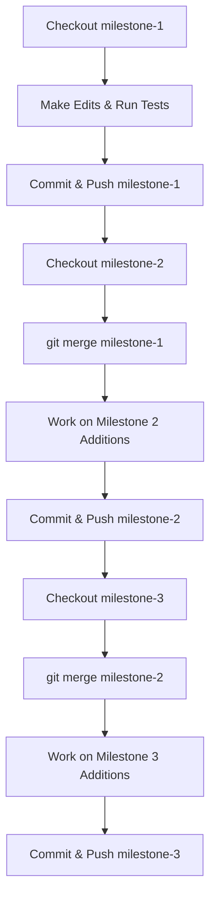

# SYNAPSE Continual Learning Framework
# Multi-Milestone Development & Progression Guide

## 1. Overview & Branch Architecture

This repository is organized into three independent milestones that build upon each other in a cumulative progression. Each milestone is captured in its own Git branch:

```
[v1.0-baseline] ───► milestone-1 (Core Tier 1 Titans NLTM, Qwen 2.5 Hooks, Sleep, Dreaming, TRACE)
       │
       ▼
[v2.0-baseline] ───► milestone-2 (M1 + Pillars A-D: Latent Router, DARE-TIES Merging, Safety, Async Runtime)
       │
       ▼
[v3.0-baseline] ───► milestone-3 (M2 + Pillars E-H: MIRAS Robust Memory, Tool Guard, Atomic Editor, Debate)
```

- **`milestone-1`**: Base continual learning architecture (Phases 1–4).
- **`milestone-2`**: Autonomous routing, parameter compaction, safety guardrails, and async serving (Pillars A–D).
- **`milestone-3`**: Complete Single Source of Truth (SSOT), MIRAS robust memory, tool preservation, atomic fact editing, and debate verifier (Pillars E–H).
- **`master` / `main`**: Latest consolidated state.

---

## 2. Remote Configuration (GitHub / GitLab)

If you haven't yet pushed the repository to GitHub or GitLab, run:

```bash
# 1. Add your remote origin (replace with your repository URL)
git remote add origin git@github.com:USERNAME/REPOSITORY.git
# or: git remote add origin https://github.com/USERNAME/REPOSITORY.git

# 2. Push all milestone branches and baseline tags
git push -u origin milestone-1
git push -u origin milestone-2
git push -u origin milestone-3
git push -u origin master
git push --tags
```

---

## 3. Sequential Development Workflow

Follow this cycle to make additions to Milestone 1 and propagate them forward into Milestones 2 and 3 without overwriting downstream work.



---

### Step 1: Work on Milestone 1

1. Switch to the `milestone-1` branch:
   ```bash
   git checkout milestone-1
   ```

2. Make your edits, add findings, or introduce new features.

3. Verify that all Milestone 1 tests pass:
   ```bash
   python3 tests/test_fast_memory.py
   python3 tests/test_sleep_consolidation.py
   python3 tests/test_dreaming_engine.py
   python3 tests/test_phase4_runtime.py
   ```

4. Commit your changes and push to remote:
   ```bash
   git add .
   git commit -m "Milestone 1: Add new findings and features"
   git push origin milestone-1
   ```

---

### Step 2: Propagate Milestone 1 into Milestone 2

Once Milestone 1 is completed and pushed, bring its changes into Milestone 2:

1. Switch to the `milestone-2` branch:
   ```bash
   git checkout milestone-2
   ```

2. Merge your completed `milestone-1` branch:
   ```bash
   git merge milestone-1 -m "Merge completed Milestone 1 findings into milestone-2"
   ```
   *Why this is safe:* Git uses `v1.0-baseline` as the common ancestor. It brings in only the newly added/modified code from Milestone 1 and leaves all Milestone 2 files (`autonomous_latent_router.py`, `expert_merging_engine.py`, etc.) intact.

3. Continue your Milestone 2 development and run tests:
   ```bash
   python3 tests/test_autonomous_routing.py
   python3 tests/test_expert_merging.py
   python3 tests/test_safety_guardrails.py
   python3 tests/test_async_runtime.py
   ```

4. Commit and push Milestone 2:
   ```bash
   git add .
   git commit -m "Milestone 2: Enhancements and evaluation complete"
   git push origin milestone-2
   ```

---

### Step 3: Propagate Milestone 2 into Milestone 3

Once Milestone 2 is completed and pushed, bring all cumulative changes into Milestone 3:

1. Switch to the `milestone-3` branch:
   ```bash
   git checkout milestone-3
   ```

2. Merge your completed `milestone-2` branch:
   ```bash
   git merge milestone-2 -m "Merge completed Milestone 2 findings into milestone-3"
   ```
   *Why this is safe:* Git uses `v2.0-baseline` as the common ancestor. All work from Milestones 1 and 2 flows cleanly into Milestone 3.

3. Continue your Milestone 3 development and run the complete 12-test suite:
   ```bash
   python3 tests/test_miras_yaad.py
   python3 tests/test_continual_tool_guard.py
   python3 tests/test_surgical_atomic_editor.py
   python3 tests/test_debate_dreaming.py
   ```

4. Commit and push Milestone 3:
   ```bash
   git add .
   git commit -m "Milestone 3: Final lifelong adaptation complete"
   git push origin milestone-3
   ```

---

## 4. Alternative: Non-Merge Workflows

If your instructor, reviewer, or automated grader forbids merge commits:

### Option A: Cherry-Pick (Transfer specific commits)
```bash
# On milestone-1, inspect your commit hashes
git log --oneline -n 5

# Switch to milestone-2 and replay the commits
git checkout milestone-2
git cherry-pick <COMMIT_HASH_1> <COMMIT_HASH_2>
```

### Option B: Selective File Checkout (Transfer specific files)
```bash
# While on milestone-2, checkout specific files modified in milestone-1
git checkout milestone-2
git checkout milestone-1 -- core/titans_nltm.py core/sleep_orchestrator.py
git commit -m "Sync updated Tier 1 memory modules from milestone-1"
```

---

## 5. Verification Commands by Milestone

| Milestone | Modules Under Test | Verification Command |
| :--- | :--- | :--- |
| **Milestone 1** | Tier 1 NLTM, Sleep SVD, Dreaming, Registry | `python3 tests/test_fast_memory.py && python3 tests/test_sleep_consolidation.py && python3 tests/test_dreaming_engine.py && python3 tests/test_phase4_runtime.py` |
| **Milestone 2** | Pillars A, B, C, D | `python3 tests/test_autonomous_routing.py && python3 tests/test_expert_merging.py && python3 tests/test_safety_guardrails.py && python3 tests/test_async_runtime.py` |
| **Milestone 3** | Pillars E, F, G, H | `python3 tests/test_miras_yaad.py && python3 tests/test_continual_tool_guard.py && tests/test_surgical_atomic_editor.py && tests/test_debate_dreaming.py` |
| **All Milestones** | Full End-to-End Regression Suite | Run all 12 test files sequentially |

---

## 6. Resolving Merge Conflicts (If Any Occur)

If a merge produces a conflict on a file both branches modified:

1. Check conflicting files:
   ```bash
   git status
   ```
2. Open the conflicting file, locate `<<<<<<<`, `=======`, and `>>>>>>>` markers.
3. Choose the desired combination of edits.
4. Stage and complete the merge:
   ```bash
   git add <resolved-file>
   git commit -m "Resolve merge conflict between milestones"
   ```
